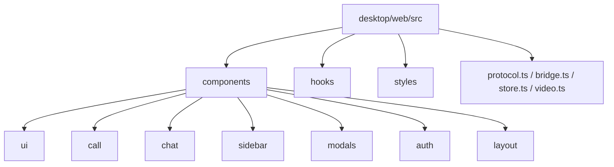

# Plano — Refatoração estrutural conservadora do frontend

> **Auditoria de código morto (22/10)** — descobertas que ajustam o escopo:
> - `video.ts` exporta funções **ativas** (`setOccluders`, `setStageOccluders`, `suspendOverlays`,
>   `overlaysSuspended`, `attachCanvas`) usadas por CallView/ContextMenu/ModalLayer/VideoTile. Apenas o
>   caminho "Path B" (`startVideo`, `WebViewShared`, `chrome.webview`, `sharedbufferreceived`) é legado
>   do WebView2/C++ e pode ser removido. O núcleo Rust/Tauri usa "Path A" (janelas nativas).
> - `neon/glow`: os tokens `--tri-neon-*`/`--tri-glow-*` em `workspace.css` são aliases neutralizados
>   (mapeiam para `--ui-accent`/`--ui-positive`/`none`) e as classes `text-neon-*`/`shadow-glow` são
>   neutralizadas por seletor `[class*="..."]`. É código de compatibilidade, não morto — remoção é
>   opcional e de baixo risco, não obrigatória.
> - `cotton-candy` é um tema válido em `protocol.ts` (não é código morto).
> - `AudioRipple`/`useSpeakingHold` são usados ativamente (não são mortos).
> - `TriscordLogo` mantém a prop `glow` retida para compatibilidade de chamadores.

## Objetivo

Reorganizar o frontend Preact/TypeScript de [`desktop/web/src`](../desktop/web/src) sem alterar
comportamento, visual ou contratos. Paridade pixel e contratos IPC intactos.

## Restrições

- Manter Preact 10 + TypeScript + esbuild + Tailwind 3.4 (sem Next.js, sem nova lib de testes).
- Preservar [`protocol.ts`](../desktop/web/src/protocol.ts) (snapshot/delta + comandos) e
  [`store.ts`](../desktop/web/src/store.ts) (revisões) como estão.
- Preservar a direção visual Ônix/azul aprovada e o tema padrão `midnight`.
- Não reordenar imports de CSS (ordem de cascata afeta paridade pixel).
- Validação apenas com testes unitários Node + `tsc --noEmit` + build (padrão e `--tauri`).
  Sem abrir app, navegador, dispositivos ou E2E.

## Estrutura alvo

- `components/ui/` — primitivas: Icon, Tooltip, Modal, ModalLayer, StatePanel, ShimmerButton,
  DeviceSelect, AudioRipple, TriscordLogo, ContextMenu, NoticeToast, FullscreenHint, useSpeakingHold.
- `components/call/` — CallView, VideoTile, SharePicker, CameraPreview, AudioMenu, Soundboard,
  PeerAudio, ParticipantProfile, ParticipantMenu, AccountPanel, AccountPopover, ChannelHeader.
- `components/chat/` — ChatPanel, ChatComposer, Markdown.
- `components/sidebar/` — ServerRail, ChannelSidebar, WorkspaceNav, WorkspaceHome, MemberList, FriendsView.
- `components/modals/` — ServerModal, CreateChannelModal, InviteModal, ServerRemovalModal,
  DeleteMessageModal, QuickSwitcher, Settings, ProfileEditor.
- `components/auth/` — LoginScreen.
- `components/layout/` — TitleBar, ChannelView, app.tsx.
- `hooks/` — hooks extraídos de app.tsx e ChannelView.tsx.

## Etapas

1. **Baseline** — rodar `npm run typecheck`, `npm run test:unit` e `npm run build` (e `--tauri`)
   e registrar resultado verde antes de qualquer mudança.
2. **Auditoria de código morto** — grep por referências a `WebView2Bridge`, `rust-preview`,
   classes `neon-*`/`glow-*` e CSS órfão; registrar itens confirmados.
3. **Remover WebView2Bridge** — o núcleo C++ foi removido; restam apenas TauriBridge (real) e
   FixtureBridge (dev/testes). Atualizar `createBridge`.
4. **Remover rust-preview.tsx** — página dev legada e o branch `?preview` de `main.tsx`, se confirmado sem uso.
5. **Remover tokens neon/glow** — neutralizados no `tailwind.config.cjs` (sombras `none`), após confirmar ausência de uso.
6. **Extrair hooks de app.tsx** — atalhos globais (Ctrl+K/B/U, Escape), controlador de modais,
   sincronização de tema, efeitos sonoros e listeners `tri-*`.
7. **Extrair hooks de ChannelView.tsx** — foco de chamada (`callFocus`), toggle de chat/membros e idle.
8. **Decompor Settings.tsx** — arquivos por seção (Conta, Notificações, Voz, Aparência, Windows)
   e componentes compartilhados (Switch, Slider, modais).
9. **Decompor CallView.tsx** — ParticipantCard, ControlsBar, menus e layout de grade.
10. **Reorganizar pastas** — mover componentes para as pastas de domínio e atualizar imports.
11. **Centralizar eventos `tri-*`** — módulo tipado com nomes e payloads, sem mudar o mecanismo DOM.
12. **Atualizar testes** — ajustar imports nos testes Node e adicionar testes para hooks extraídos.
13. **Verificação final** — typecheck, testes unitários Node e build padrão/`--tauri` verdes.
14. **Documentação** — atualizar notas refletindo a nova estrutura.

## Resultado (22/10)

Refatoração estrutural conservadora concluída, com paridade pixel e contratos intactos. Validação:
`tsc --noEmit`, testes unitários Node (incluindo o novo `test-hooks.mjs`) e build padrão/`--tauri` verdes.
Nenhum app, navegador, dispositivo ou E2E foi executado.

- **Código morto removido**: `WebView2Bridge` e o branch `chrome.webview` de [`bridge.ts`](../desktop/web/src/bridge.ts);
  o caminho "Path B" (shared buffers) de [`video.ts`](../desktop/web/src/video.ts) e o branch `shared-buffer` de
  [`VideoTile.tsx`](../desktop/web/src/components/VideoTile.tsx); `rust-preview.tsx`/`rust-preview.css` e o branch
  `?preview` de [`main.tsx`](../desktop/web/src/main.tsx).
- **Hooks extraídos**: [`hooks/useAppChrome.ts`](../desktop/web/src/hooks/useAppChrome.ts) (atalhos globais,
  controlador de modais, tema, sons, relay de eventos, escape de fullscreen, reset ao sair) e
  [`hooks/useCallFocus.ts`](../desktop/web/src/hooks/useCallFocus.ts) (foco da chamada).
- **Componentes decompostos**: [`Settings.tsx`](../desktop/web/src/components/Settings.tsx) agora orquestra seções em
  [`components/settings/`](../desktop/web/src/components/settings) (`controls.tsx`, `sections.tsx`);
  [`CallView.tsx`](../desktop/web/src/components/CallView.tsx) delega `ParticipantCard` e `ControlsBar` a
  [`components/call/`](../desktop/web/src/components/call).
- **Eventos centralizados**: [`events.ts`](../desktop/web/src/events.ts) tipa os nomes/payloads `tri-*` sem mudar o
  mecanismo `dispatchEvent`/`addEventListener`.
- **Testes**: novo [`tools/test-hooks.mjs`](../desktop/web/tools/test-hooks.mjs) valida exports dos hooks e a
  centralização dos nomes de eventos; adicionado ao `test:unit`.

A reorganização em pastas de domínio adicionais (`chat/`, `sidebar/`, `modals/`, `auth/`, `layout/`) foi avaliada e
deixada de fora: os componentes restantes já estão bem nomeados e coesos em `components/`, e o churn de imports não
traria ganho proporcional ao risco. As subpastas `call/` e `settings/` cobrem os grupos mais coesos.

## Riscos e mitigação

- **Ordem de CSS**: não reordenar imports; manter a lista de `main.tsx` intacta (ou consolidar em
  `styles/index.css` preservando a ordem exata).
- **Import paths**: mover arquivos exige atualizar todos os imports; mitigar com `tsc --noEmit`
  após cada movimento e testes de contrato.
- **Eventos globais**: manter o mecanismo `dispatchEvent`/`addEventListener`; apenas tipar nomes/payloads.
- **Código morto**: remover somente itens confirmados por grep; itens duvidosos ficam documentados.