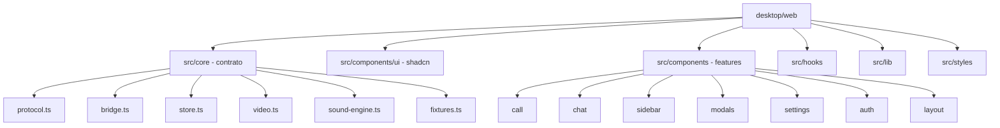

# Plano — Reescrita completa do frontend (React)

## Decisões

- **Stack**: React + TypeScript + Vite + Tailwind CSS + shadcn/ui + Lucide React + Motion (Framer Motion).
  **Sem Zustand** — o núcleo Rust/Tauri já é a fonte de verdade do estado (snapshot/delta).
- **Validação**: `tsc --noEmit` + testes unitários + build (Vite e Rust via `build.ps1`). Sem abrir app,
  navegador, dispositivos ou E2E; sem medir FPS (fluidez é objetivo de implementação, não promessa medida).
- **Escopo**: reescrever `desktop/web` por completo. O núcleo Rust/Tauri e o contrato IPC ficam intactos.

## O que preservar (contrato com o núcleo Rust)

Estes arquivos são a fronteira com o núcleo e **não mudam de forma** (o `Command` do Rust usa
`deny_unknown_fields`; qualquer divergência quebra o IPC):

- [`protocol.ts`](../desktop/web/src/protocol.ts) — tipos, `Command` e `CoreMessage`.
- [`bridge.ts`](../desktop/web/src/bridge.ts) — `TauriBridge` (`invoke('dispatch')` + `event.listen('triscord-core')`)
  e `FixtureBridge` (dev/testes).
- [`store.ts`](../desktop/web/src/store.ts) — `SessionStore` (snapshot/delta com revisões); portar `useSession`
  de `preact/hooks` para `useSyncExternalStore` do React.
- [`video.ts`](../desktop/web/src/video.ts) — Path A: reporte de geometria das janelas nativas
  (`videoSurface`, `videoOccluders`, `videoRole`, `videoIdle`) e eventos `videoClick`/`videoContextMenu`.
- [`sound-engine.ts`](../desktop/web/src/sound-engine.ts) — reprodução local dos sons de chamada.
- [`fixtures.ts`](../desktop/web/src/fixtures.ts), [`events.ts`](../desktop/web/src/events.ts),
  [`call-status.ts`](../desktop/web/src/call-status.ts), [`share-sources.ts`](../desktop/web/src/share-sources.ts),
  [`focus-policy.ts`](../desktop/web/src/focus-policy.ts) — lógica pura, framework-agnóstica.
- Assets de som (`desktop/assets/call-sounds`, `desktop/assets/soundboard`) e o glyph/logo.

## O que remover

- Todos os componentes Preact (`components/*.tsx`), todos os CSS (`styles/*.css`),
  [`build.mjs`](../desktop/web/tools/build.mjs), [`tailwind.config.cjs`](../desktop/web/tailwind.config.cjs),
  `icons.generated.ts`, `tokens.generated.css`, `theme-cotton-candy.generated.css`, `motion.generated.css`,
  `tailwind.generated.css` e os testes Node legados (substituídos por equivalentes na nova stack).

## Arquitetura alvo

- `src/core/` — camada de contrato (framework-agnóstica, preservada).
- `src/components/ui/` — primitivas shadcn/ui (Button, Dialog, DropdownMenu, Tooltip, Popover, Slider,
  Switch, Tabs, ScrollArea, ContextMenu, Avatar, etc.).
- `src/components/` — features por domínio (call, chat, sidebar, modals, settings, auth, layout).
- `src/hooks/` — hooks React (`useSession`, `useCallFocus`, etc.).
- `src/lib/` — utilitários.
- `src/styles/` — CSS global + Tailwind.

## Direção de design (minha decisão)

O redesign anterior (midnight/azul) **não é restrição** — o usuário liberou decisões próprias. Direção proposta,
a ser refinada pelo fluxo `impeccable init` + `new-work`:

- **Modo**: Operate (app de tarefas — voz, vídeo, chat, compartilhamento, servidores, configurações).
- **Mundo visual**: "studio dark" — base neutra profunda com leve sub-tom frio, superfícies em camadas por
  passos sutis de luminosidade, um único acento de marca distinto (evitando o indigo/roxo genérico), cores
  semânticas para estado (verde=online/falando, vermelho=crítico, âmbar=aviso).
- **Tipografia**: sans variável moderna (Inter ou Geist), afastando-se do "gg sans" do Discord para identidade própria.
- **Profundidade**: sutil — bordas de 1px e sombras mínimas, sem glow/neon.
- **Motion**: springs com física cuidada, animações apenas em `transform`/`opacity` (120fps), respeito a
  `prefers-reduced-motion`.
- **Som**: feedback discreto e satisfatório, integrado às ações, com volume/desativação.

## Etapas

Ver a lista de tarefas (22 itens) — ordem de execução: fundação/contrato → design system → shell → chat →
chamada/mídia → modais/settings/perfil → motion/som → acessibilidade/performance → testes → verificação.

## Riscos e mitigação

- **Contrato IPC**: `protocol.ts` deve permanecer idêntico ao `Command` do Rust (`deny_unknown_fields`).
  Não renomear/alterar comandos; validar com `tsc` e os testes de contrato.
- **Vídeo nativo (Path A)**: o reporte de geometria é acoplado ao DOM; preservar `video.ts` e garantir que os
  novos `VideoTile`/`CallView` reportem `videoSurface`/`videoOccluders`/`videoRole` corretamente.
- **Build Vite + Tauri**: atualizar `frontendDist` e `build.ps1`; ajustar CSP para o bundle Vite; preservar a
  cópia de fontes locais e o modo fixture (dev/testes sem Tauri).
- **Dual-mode**: manter `createBridge` (Tauri vs Fixture) para que dev/testes continuem sem o núcleo.
- **120fps**: animar só `transform`/`opacity`, memoizar componentes de alta frequência, evitar layout thrash;
  não prometer FPS não medido.